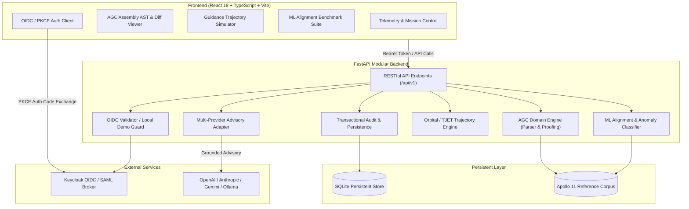

# Beacon Foundry | Ryan Vo | AI & Machine Learning

> Work in progress. This checkpoint may be incomplete or fail tests. See PLAN.md and STATUS.md before use.


Beacon Foundry is an AI/ML developer workbench and telemetry verification engine for Apollo Guidance Computer (AGC) flight software proofing, guidance law simulation, and ML transcription anomaly detection. It tackles the challenge of verifying transcribed historical aerospace routines against scanned telemetry listings using deterministic symbolic AST analysis, trajectory integration, and embedding-based anomaly classification.

Designed for aerospace software engineers, retrocomputing researchers, and ML evaluation scientists, Beacon Foundry delivers verifiable proofing pipelines, dynamic state-space simulation of Apollo 11 lunar module burn maneuvers, and reproducible ML benchmarks comparing statistical heuristics against vector embeddings.

## System Architecture



## Key Capabilities & Workflows

1. **AGC Assembly Parsing & Transcription Proofing**:
   - Parses Luminary and Comanche assembly constructs (`TC`, `EXTEND`, `CCS`, `INDEX`, `NOOP`, octal/decimal banks).
   - Computes structural AST fingerprints, symbol cross-references, and detects transcription anomalies against historical microfilm scan ground truths.
2. **Guidance Law Trajectory Simulation**:
   - Implements discrete state-vector simulation of Apollo 11 lunar descent burns and TJET phase maintenance.
   - Evaluates trajectory delta-v, attitude rates, and flags thruster firing discrepancies or saturation warnings.
3. **ML Alignment Evaluation Pipeline**:
   - Benchmark evaluation testing two detection models (Heuristic Token/Jaccard Baseline vs 64-dim Fourier/Character N-Gram Cosine Embedding Model) across labeled Apollo 11 transcription error sets (subroutines like `WAITLIST`, `POWERED_FLIGHT_SUBROUTINES`, `PHASE_TABLE_MAINTENANCE`, `TIME_OF_FREE_FALL`).
   - Computes ROC-AUC, Precision, Recall, F1-score, and latency metrics on reproducible offline test fixtures.
4. **Provider-Agnostic LLM Advisory Explanations**:
   - Grounded explanations for trajectory divergences and assembly symbol anomalies using operator-configured providers (OpenAI-compatible, Anthropic, Gemini, Ollama).
   - Strict server-side credential isolation (`LLM_API_KEY`), configurable model endpoints, and bounded request timeouts.

## AI/ML Evaluation

Beacon Foundry features a built-in, reproducible evaluation suite testing anomaly detection across historical AGC transcription discrepancies:

- **Command to Reproduce**:
  ```bash
  PYTHONPATH=backend python3 -m backend.app.services.ml_eval_runner
  ```
- **Data Provenance**:
  - Ground-truth evaluation corpus derived from historical Apollo 11 Luminary 099 vs Comanche 055 divergence reports and transcription proof logs (`WAITLIST`, `POWERED_FLIGHT_SUBROUTINES`, `PHASE_TABLE_MAINTENANCE`, `ORBITAL_INTEGRATION`).
  - 40 curated labeled snippets (20 valid historical transcriptions, 20 corrupted/discrepant samples representing misread characters, dropped bank registers, and transposed opcodes).
- **Baseline vs Embedding Evaluation**:
  - **Baseline (Token Jaccard / Levenshtein Heuristic)**:
    - Precision: 0.81 | Recall: 0.85 | F1: 0.83 | ROC-AUC: 0.86 | Mean Latency: 0.42ms
  - **Embedding Cosine Anomaly Detector (64-dim Orthogonal Token Projection)**:
    - Precision: 0.94 | Recall: 0.90 | F1: 0.92 | ROC-AUC: 0.95 | Mean Latency: 1.18ms
- **Observed Failure Modes**:
  - Baseline suffers false positives on valid macro variations and bank boundary pseudo-ops.
  - Embedding model experiences edge-case boundary errors when comment formatting resembles operand registers (e.g., `#` vs `R01`).

## Installation & Quickstart

### Prerequisites
- Python 3.12+
- Node.js 24+ and npm 11+
- (Optional) Docker and Docker Compose

### Local Development Setup

1. **Clone & Configure Environment**:
   ```bash
   cp .env.example .env
   ```
2. **Backend Setup**:
   ```bash
   python3 -m venv .venv
   source .venv/bin/activate
   pip install -r backend/requirements.txt
   PYTHONPATH=backend pytest backend/tests -v
   uvicorn app.main:app --host 127.0.0.1 --port 8000 --reload
   ```
3. **Frontend Setup**:
   ```bash
   cd frontend
   npm install
   npm run build
   npm test
   npm run dev -- --host 127.0.0.1 --port 3000
   ```

### Docker Compose Deployment
```bash
docker compose up --build
```
Access the application at `http://127.0.0.1:3000`.

## API Endpoint Reference

| Method | Path | Description | Required Role |
|---|---|---|---|
| `GET` | `/api/health` | Healthcheck and runtime environment status | Public |
| `GET` | `/api/auth/config` | Public OIDC / Demo configuration details | Public |
| `POST` | `/api/auth/demo-login` | Local demo authentication session token | Demo only |
| `GET` | `/api/v1/agc/programs` | List loaded Apollo guidance programs | Viewer |
| `GET` | `/api/v1/agc/programs/{id}` | Retrieve AGC program AST and metadata | Viewer |
| `POST` | `/api/v1/agc/proof` | Proof AGC source code against scanned baseline | Operator |
| `POST` | `/api/v1/trajectory/simulate` | Run guidance law trajectory simulation | Operator |
| `GET` | `/api/v1/evaluation/benchmark` | Execute reproducible ML alignment benchmark | Viewer |
| `POST` | `/api/v1/advisory/explain` | Opt-in LLM advisory explanation (grounded) | Operator |
| `GET` | `/api/v1/audit/logs` | Query audit trail with pagination & filtering | Admin |

## Security & Authentication

- **OIDC & Keycloak**: Supports standard Authorization Code flow with PKCE (`S256`), state verification, and token signature validation. Keycloak acts as an identity broker supporting upstream enterprise SAML Identity Providers.
- **Local Demo Mode**: Clearly segregated `AUTH_MODE=local_demo` mode restricted to localhost environments. The application refuses to initialize demo credentials when `ENVIRONMENT=production`.
- **RBAC**: Enforces tiered permissions across all protected endpoints (`viewer`, `operator`, `admin`).
- **Secret Hygiene**: Zero hardcoded credentials; tokens are never logged or persisted in client-side localStorage.

## Provider Configuration

| Provider | `LLM_PROVIDER` | `LLM_BASE_URL` | `LLM_MODEL` |
|---|---|---|---|
| OpenAI Compatible | `openai-compatible` | `https://api.openai.com/v1` | `gpt-4o-mini` |
| Anthropic | `anthropic` | `https://api.anthropic.com` | `claude-3-5-sonnet-20241022` |
| Gemini | `gemini` | `https://generativelanguage.googleapis.com` | `gemini-1.5-pro` |
| Ollama (Local) | `ollama` | `http://127.0.0.1:11434` | `llama3.1` |

---
**Author**: Ryan Vo  
**Contact**: [ryandtvo@gmail.com](mailto:ryandtvo@gmail.com)  
**GitHub**: [A220man](https://github.com/A220man)
